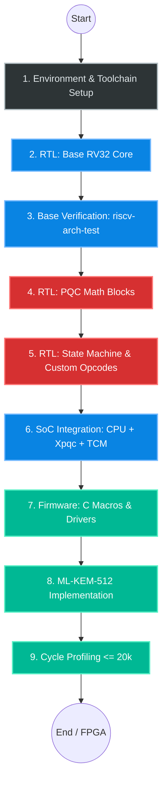

# RISC-V PQC Microcontroller — Project Roadmap

The following roadmap uses standard Mermaid.js (natively supported by GitHub in `.md` files) to render a graphical visualization on your repository page, followed by a detailed step-by-step action plan.

## Architecture and Project Flow

---

## 🗺️ Detailed Action Plan (Step-by-Step)

### Phase 1: Foundations & Environment (Crucial Start)
Before writing a single line of Verilog, you need the tools to test it.
- [ ] **Toolchain Installation:** Download and build the `riscv-gnu-toolchain` (configured for rv32i).
- [ ] **RTL Simulator:** Install Verilator (for fast C++ simulation) or Icarus Verilog.
- [ ] **Test Environment:** Install Python and the Cocotb library.
- [ ] **Repository Setup:** Initialize Git, create the directory structure, and commit the `architecture_spec.md` file.

### Phase 2: Base CPU Core (rv32i_zmmul)
Building a standard processor without cryptography to execute base C code.
- [ ] **Fetch:** Instruction fetch from I-TCM and Program Counter (PC) increment.
- [ ] **Decode:** Decode standard RISC-V opcodes (Load, Store, ALU, Branch).
- [ ] **RegFile:** Implement the 32x32-bit register file.
- [ ] **Execute (ALU):** Addition, shifts (Zbb), bitwise operations.
- [ ] **Multiplier (zmmul):** Simple hardware multiplier in the EX stage.

### Phase 3: First Blood (Base Verification)
The processor must work flawlessly before introducing any custom modifications.
- [ ] Hook up the official `riscv-arch-test` suite for the `rv32i` profile.
- [ ] Verify and debug Branches and Load/Store instructions.
- [ ] Write and execute a classic "Blink LED" program in pure C.

### Phase 4: PQC Accelerator (The Core)
Leaving the CPU context to design the custom hardware crypto module (`rtl/pqc`).
- [ ] **Keccak-f[1600]:** Hardware block for sponge permutation. Verify against NIST test vectors using Cocotb.
- [ ] **NTT Memory:** Build the internal SRAM capable of holding 4 polynomials (4 KB total).
- [ ] **Butterfly Unit (NTT):** Modular multiplication module for a single coefficient.
- [ ] **State Machine (FSM):** Controller managing the INIT, LOAD, COMPUTE, and EXTRACT operations.

### Phase 5: Tightly-Coupled Integration
Bridging the standard processing world (CPU) with the crypto world (PQC).
- [ ] Add Custom-0 (`0x0B`) support in the instruction decoder (handling pipeline stalls).
- [ ] Hook up the PQC accelerator to the core's register read/write ports (`rs1`, `rs2`, `rd`).
- [ ] Implement the Wishbone bus for peripheral management (UART, Timer).

### Phase 6: Software (Firmware)
The hardware is ready; time to control it from C.
- [ ] Define C macros in `firmware/pqc_custom_op.h` using the `.insn` directive.
- [ ] Replace slow C reference functions (from `pqm4` or NIST ref) with hardware accelerator calls.
- [ ] Deploy the hybrid ML-KEM-512 logic (CPU handles control flow, `Xpqc` handles the math).

### Phase 7: Performance Tuning (Sub-20k Cycles)
- [ ] Run full KEM Encaps/Decaps operations in hardware simulation.
- [ ] Measure cycle counts using control registers (`zicsr`).
- [ ] Identify bottlenecks (Are Load/Stores too slow? Is NTT stalling too long?) and optimize the Verilog microarchitecture.
