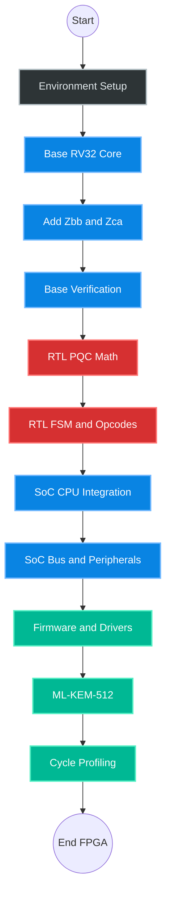

# RISC-V PQC Microcontroller — Project Roadmap

The following roadmap uses standard Mermaid.js (natively supported by GitHub in `.md` files) to render a graphical visualization on your repository page, followed by a detailed step-by-step action plan.

## Architecture and Project Flow

---

## 🗺️ Detailed Action Plan (Step-by-Step)

### Phase 1: Foundations & Environment (Crucial Start)

Before writing a single line of Verilog, you need the tools to test it.

- [ ] **Toolchain Installation:** Download and build the `riscv-gnu-toolchain` (configured for `rv32i_zbb_zca_zicsr_zmmul`).
- [ ] **RTL Simulator:** Install Verilator (for fast C++ simulation) or Icarus Verilog.
- [ ] **Test Environment:** Install Python and the `cocotb` library.
- [ ] **Repository Setup:** Initialize Git, create the directory structure, and commit the `architecture_spec.md` file.
- [ ] **CI Skeleton:** Set up GitHub Actions with a placeholder job (lint + sim) that will become the full regression in later phases.

---

### Phase 2: Base CPU Core (`rv32i_zmmul` + TCM + CSRs)

Building the standard processor foundation without cryptography.

- [ ] **I-TCM (32 KB):** Dual-port SRAM, zero-wait-state instruction fetch port.
- [ ] **D-TCM (32 KB):** Dual-port SRAM, zero-wait-state data read/write port.
- [ ] **Fetch:** Instruction fetch from I-TCM, Program Counter (PC) increment.
- [ ] **Decode:** Decode standard RISC-V opcodes (Load, Store, ALU, Branch, CSR).
- [ ] **RegFile:** Implement the 32×32-bit register file (write-in-first-read, x0 hardwired to 0).
- [ ] **Execute (ALU):** Addition, subtraction, shifts, bitwise operations.
- [ ] **Multiplier (`zmmul`):** Simple hardware multiplier in the EX stage (MULH, MULHU, MULHSU, MUL).
- [ ] **CSR File:** Implement `mstatus`, `mie`, `mip`, `mcycle`, `mcause`, `mtvec`. (Required for interrupts in Phase 6b and cycle counting in Phase 9.)

---

### Phase 2b: ISA Extensions (`zbb` + `zca`)

Complete the full target ISA string before verification.

- [ ] **Zbb:** Add bit-manipulation instructions (`clz`, `ctz`, `rev8`, `andn`, `orn`, `xnor`, `sext.b`, `zext.b`, `min`, `max`, etc.).
- [ ] **Zca:** Add compressed instruction decode (16-bit C.ADDI, C.LW, C.SW, C.J, C.BEQZ, C.MV, C.ADD, etc.).
- [ ] Re-run any ad-hoc smoke tests to confirm no regressions.

---

### Phase 3: Base Verification (First Blood)

The processor must work flawlessly before introducing any custom modifications.

- [ ] **`riscv-arch-test`:** Hook up the official suite configured for `rv32i_zbb_zca_zicsr_zmmul` (exclude `div`/`rem` tests). Run to green.
- [ ] **C ISA Reference Model:** Build (or wrap Spike) a C-based golden model. Wire it into cocotb as the comparison oracle — every cocotb test dumps the final register file and compares against the C model.
- [ ] **Minimal C Runtime:** Write `crt0.S` (set `sp`, call `_start`), a linker script (I-TCM at `0x0000_0000`, D-TCM at `0x0800_0000`), and a bare-metal `libc` stub.
- [ ] **Magic Value Test:** Write a C program that computes a known value and stores it to a fixed D-TCM address. The cocotb testbench reads that address and asserts the expected result. This proves the CPU and memory subsystem function correctly.
- [ ] **Branch & Load/Store Debug:** Targeted cocotb tests for taken/not-taken branches, all load/store widths, and misaligned access behavior.

---

### Phase 4: PQC Accelerator — Math Blocks

Designing the custom hardware crypto modules in `rtl/pqc/`. Each block is verified in isolation against a C reference before integration.

- [ ] **C PQC Reference Model:** Wrap NIST's reference ML-KEM-512 implementation in C. Generate golden test vectors (input polynomials → expected output) for cocotb comparison.
- [ ] **Keccak-f[1600]:** Hardware block for the 24-round sponge permutation. 1600-bit state register. Verify against NIST FIPS 202 test vectors using cocotb.
- [ ] **NTT 4-Slot SRAM:** 4 KB tightly-coupled SRAM inside the accelerator, organized as 4 × 256-word polynomial slots.
- [ ] **Butterfly Unit (Dual-Prime):** Modular multiply-add unit with a **48-bit datapath** supporting both q = 3329 (ML-KEM) and q = 8380417 (ML-DSA). Two twiddle-factor ROMs (or reconfigurable). Target arithmetic precision and modular reduction must be verified before phase integration.
- [ ] **iNTT:** Inverse NTT using the same butterfly unit with pre-computed inverse twiddles.
- [ ] **Pointwise Multiply Unit:** Element-wise multiply mod q of two polynomial slots (256 × 48-bit multiplies, pipelined).
- [ ] **Polynomial Add/Sub Unit:** Element-wise add and subtract mod q in the time domain.
- [ ] **Cocotb Verification:** Each block verified against the C reference model with randomized inputs before moving to Phase 5.

---

### Phase 5: PQC Accelerator — FSM & Custom Opcodes

The controller that orchestrates the math blocks into the INIT → LOAD → COMPUTE → EXTRACT lifecycle.

- [ ] **FSM Design:** State machine managing: `IDLE`, `INIT`, `LOAD_BLK`, `COMPUTE_NTT`, `COMPUTE_INTT`, `COMPUTE_PMUL`, `COMPUTE_ADD`, `COMPUTE_SUB`, `STORE_BLK`, `BUSY`.
- [ ] **Stall Interface:** `busy` signal back to the CPU EX stage (halts pipeline). `done` signal for interrupt/CSR flag.
- [ ] **Instruction Decode Table:** Implement the full `Xpqc` instruction set (see spec §9) including `pqc.k.*`, `pqc.ntt.*`, `pqc.poly.*`.
- [ ] **Slot Selection:** `rs2` encodes destination/source slot index (0–3) for block and compute instructions.
- [ ] **Cocotb Verification:** Full accelerator testbench — feed a complete ML-KEM-512 Encaps sequence of `Xpqc` instructions and compare final output against the C reference.

---

### Phase 6a: SoC Integration — CPU Side

Bridging the standard CPU with the PQC accelerator.

- [ ] **Custom-0 Decode:** Add `0x0B` opcode recognition in the ID stage. Route `rs1`, `rs2`, `rd`, `funct3`, `funct7` to the `Xpqc` control interface.
- [ ] **Pipeline Stall Logic:** When `Xpqc` asserts `busy`, hold PC and ID/EX pipeline registers. Release on `done`.
- [ ] **Register Port Hookup:** Wire accelerator `rd` write-back to the register file EX/WB port.
- [ ] **CSR: PQC Status:** Add a custom CSR (`0x800`) exposing `busy` flag and current slot pointer for firmware polling.
- [ ] **Cocotb Integration Test:** Run a mixed program (standard RISC-V + `Xpqc` instructions) and verify correct results and no pipeline corruption.

---

### Phase 6b: SoC Integration — Bus & Peripherals

The full SoC with external interfaces.

- [ ] **Wishbone Bus (32-bit):** Single-master arbiter. CPU is the only master. Peripherals at `0x1000_0000+`.
- [ ] **Boot ROM (4 KB):** At `0x0000_0000`. Contains a small jump-to-flash or jump-to-TCM stub.
- [ ] **UART (16550-compatible):** TX/RX, 16-byte FIFO, IRQ on TX-empty and RX-not-empty.
- [ ] **GPIO (32-bit):** Input/output/IRQ.
- [ ] **Timer (32-bit):** Free-running counter + 2 compare channels. IRQ on match.
- [ ] **SPI (Master):** For external flash. Basic mode 0, up to 25 MHz.
- [ ] **Interrupt Controller:** Direct mapping to `mip`/`mie` CSRs. Fixed priority: Timer > UART > GPIO. No PLIC.
- [ ] **External Memory:** 512 KB SRAM + 4 MB SPI Flash on Wishbone.
- [ ] **Cocotb SoC Test:** Full SoC testbench — boot from ROM, load program into TCM via SPI, execute, observe UART output.

---

### Phase 7: Firmware (C Software)

Controlling the hardware from C.

- [ ] **`.insn` Macros:** Define C macros in `firmware/pqc_custom_op.h` wrapping the Custom-0 encodings for every `Xpqc` instruction.
- [ ] **PQC Driver Layer:** Thin C API (`pqc_kem_encaps()`, `pqc_kem_decaps()`) that sequences the `Xpqc` instructions.
- [ ] **Hybrid ML-KEM-512:** CPU handles control flow, CBD sampling, and byte-level I/O. `Xpqc` handles NTT, iNTT, pmul, Keccak.
- [ ] **End-to-End Test:** Run full Encaps → Decaps round-trip in simulation. Verify shared key matches C reference.

---

### Phase 8: Performance Tuning (Sub-20k Cycles)

- [ ] **Cycle Measurement:** Read `mcycle` CSR before/after the KEM operation. Log per-phase breakdown (NTT, iNTT, pmul, Keccak, load/store, control).
- [ ] **Bottleneck Analysis:** Identify top-3 cycle consumers. Common suspects: block load/store throughput, NTT stall duration, Keccak absorb instruction count.
- [ ] **Optimization Passes:**
  - Widen block load/store (16 words instead of 8) if area permits.
  - Pipeline the NTT butterfly (overlap multiply and add stages).
  - Pre-compute and cache twiddle factors in SRAM instead of ROM.
  - Reduce control overhead (batch multiple NTTs in one FSM invocation).
- [ ] **Target:** ML-KEM-512 Encaps ≤ 20,000 cycles at 50 MHz. Document final cycle count and breakdown.

---

### Phase 9: FPGA Bring-Up (Optional / Post-Silicon)

- [ ] Synthesize with Yosys + nextpnr (iCE40 or Artix-7).
- [ ] Generate bitstream, flash to target board.
- [ ] Run the same cocotb test suite via `riscv-fesim` or a custom JTAG-to-Wishbone bridge.
- [ ] Verify UART output matches simulation.
